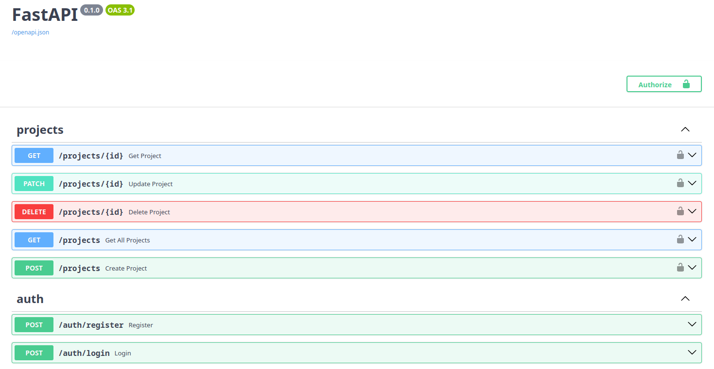

# 🖥 MebeLink Server — облачная синхронизация мебельных проектов 📦


## О проекте
**MebeLink Server** — backend-сервер для кроссплатформенного приложения **MebeLink**, разработанного для автоматизации работы небольшого мебельного цеха.

Сервер обеспечивает облачную синхронизацию проектов между устройствами: 
хранит проекты пользователей, раздаёт их по REST API и защищает данные 
JWT-аутентификацией. Клиент работает оффлайн и синхронизируется с сервером 
при появлении сети.

Сервер написан на Python с использованием FastAPI и PostgreSQL, полностью 
покрыт тестами и разворачивается одной командой через Docker Compose.

## Возможности
- 🔐 **Аутентификация** — регистрация и логин по email/паролю, JWT access-токены.
- 📁 **Управление проектами** — CRUD над проектами (название, статус, адрес, телефон, даты).
- 🔒 **Изоляция данных** — пользователь видит **только свои** проекты; чужой проект возвращает 404 (не раскрываем существование).
- ⏱ **Middleware** — замер времени выполнения каждого запроса (`X-Process-Time`).
- 📚 **Автодокументация** — Swagger UI (`/docs`) и OpenAPI (`/openapi.json`) из коробки.
- 🧪 **Тесты** — покрытие API через pytest + TestClient, чистая БД после каждого теста.
- 🐳 **Docker** — запуск сервера и PostgreSQL одной командой.

## Технологический стек
- **Python 3.14+**
- **FastAPI** — веб-фреймворк
- **PostgreSQL 18** — база данных
- **SQLAlchemy 2.0** — ORM (sync)
- **Alembic** — миграции
- **python-jose + bcrypt** — JWT и хеширование паролей
- **uv** — управление зависимостями
- **pytest** — тестирование
- **Docker + Docker Compose** — деплой

## Архитектура
Слоистая (Layered) архитектура: *HTTP → Router → Service → Repository → PostgreSQL*
- **Router** — приём запроса, DI, сериализация.
- **Service** — бизнес-логика, проверки, исключения.
- **Repository** — запросы к БД.
- **Model** — структура таблиц.

## Установка
```sh
$ git clone https://github.com/d1-boy4h/mebelink.git
$ cd mebelink-server
$ uv venv
$ uv sync
```

## Запуск и сборка
```sh
$ docker compose up --build
$ cp .env.example .env # настроить DATABASE_URL, TEST_DATABASE_URL, SECRET_KEY
$ uv run alembic upgrade head
$ uv run main.py
```

## Тесты
```sh
$ uv run pytest -v
```

## Лицензия и права
Проект разработан по заказу и используется в реальном мебельном цеху.
Исходный код публикуется с разрешения правообладателя в демонстрационных целях.

## Контакты
- Gmail: d1.boy4h@gmail.com
- Telegram: [@d1_boy4h](https://t.me/d1_boy4h)
